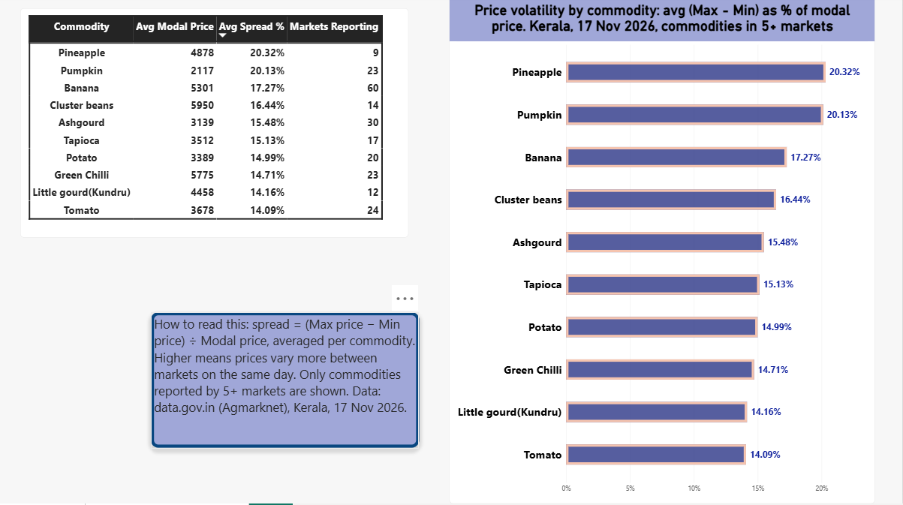
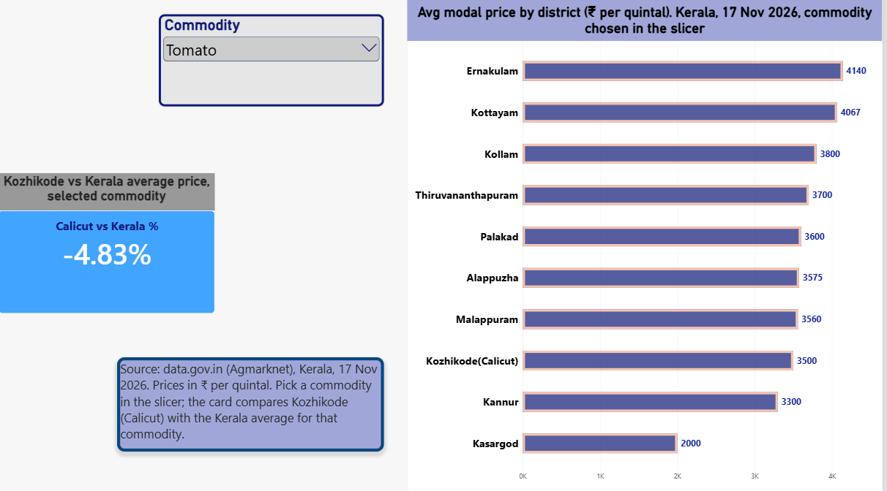

# Kerala Mandi Price Dashboard (Power BI)

A two-page Power BI report on agricultural commodity prices in Kerala's mandis (wholesale markets), built from daily data.gov.in (Agmarknet) snapshots. It answers three business questions about price volatility and district-level price differences, with a focus on Kozhikode (Calicut).

> **Data scope:** the current report is built on one daily snapshot (17 Nov 2026, 888 Kerala rows from 97 market-commodity reports). It compares commodities, districts and markets on that day. It does not show trends over time. See [Limitations](#limitations).

## Business questions

1. **Which Kerala commodities have the most volatile prices?** Measured as the average of (Max price − Min price) / Modal price, for commodities reported by at least 5 markets.
2. **How do prices for the same commodity differ across districts?** Pick a commodity in the slicer and compare districts.
3. **How does Kozhikode (Calicut) compare with the Kerala average** for the selected commodity?

## Key findings (17 Nov 2026 snapshot)

- Across commodities reported by 5+ markets, the average price spread is **12.29%** of the modal price.
- The most volatile commodities were Pineapple (20.32%, 9 markets), Pumpkin (20.13%, 23 markets) and Banana (17.27%, 60 markets). The least volatile were Black pepper (4.84%) and Garlic (4.30%).
- For Tomato, Ernakulam had the highest average modal price (4,140) and Kasargod the lowest (2,000). Kozhikode (Calicut) was at 3,500, which is **4.83% below** the Kerala average.

Prices are in ₹ per quintal (100 kg), the standard Agmarknet unit.

## Report pages

| Page | Contents |
|---|---|
| **Price Volatility** | Commodity table (modal price, spread %, number of markets) and a spread ranking chart, filtered to commodities in 5+ markets |
| **District Comparison** | Commodity slicer, district price bar chart and a Kozhikode-vs-Kerala card |

### Price Volatility


### District Comparison


## Data and preparation (Power Query)

- Source: daily CSV snapshots from data.gov.in (Agmarknet mandi prices), stored in a `raw` subfolder and combined with **Combine Files from Folder**, so new daily files are picked up on Refresh.
- Replaced "Keralam" with "Kerala" in the State column.
- Renamed the price columns to `Min_Price`, `Max_Price` and `Modal_Price`.
- Set `Arrival_Date` to a Date type.
- Filtered State to Kerala (888 of 17,093 rows in the 17 Nov file).
- Checked the price columns: numeric, no zeros or blanks.

## DAX measures

```DAX
Avg Modal Price = AVERAGE(raw[Modal_Price])

Avg Spread % =
AVERAGEX(raw, DIVIDE(raw[Max_Price] - raw[Min_Price], raw[Modal_Price]))

Markets Reporting = DISTINCTCOUNT(raw[Market])

Kozhikode Avg Price =
CALCULATE([Avg Modal Price], raw[District] = "Kozhikode(Calicut)")

Kerala Avg Price =
CALCULATE([Avg Modal Price], ALL(raw[District]))

Calicut vs Kerala % =
IF(
    ISBLANK([Kozhikode Avg Price]), BLANK(),
    DIVIDE([Kozhikode Avg Price] - [Kerala Avg Price], [Kerala Avg Price])
)
```

`Kerala Avg Price` removes the district filter so that clicking a bar in the district chart does not change the Kerala baseline. The commodity slicer still applies.

## Design choices

- **Relative spread, not rupee spread:** a ₹200 spread means very different things for a ₹2,000 vegetable and a ₹70,000 spice, so spread is shown as a percentage of the modal price.
- **5-market minimum:** commodities reported by 1 or 2 markets produced the most extreme spreads (for example 32% from a single market). Requiring 5+ markets is a judgement call, stated on the chart title.
- **One commodity at a time for district comparison:** averaging different commodities across districts would mix unlike products, so page 2 requires a commodity selection.

## Limitations

- **One day of data:** no trend or seasonality analysis is possible yet. A date table and time-series questions can be added once more daily files are collected in the `raw` folder.
- **Variety and grade are mixed** within some commodities (for example Banana has several varieties).
- **Wholesale mandi prices**, not retail prices.
- Districts with few reporting markets for a commodity can be driven by a single market's price.

## How to use

1. Clone the repository and open `KeralaMandi_Dashboard.pbix` in Power BI Desktop.
2. To update the data, add new daily CSVs to the `raw` folder (same file format) and click **Refresh**.
3. If the file path changes, update the folder path in **Transform data → Source**.

## Tools

Power BI Desktop, Power Query, DAX. Data: data.gov.in (Agmarknet).

## Author

Hiba Puthiyedath · [GitHub](https://github.com/Hiba-P) · [LinkedIn](https://linkedin.com/in/hiba-puthiyedath)
